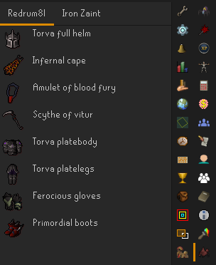
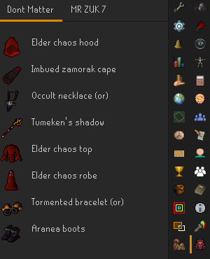
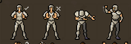

# Raid Applicant Gear Checker

Plugin to view gear of people applying to the currently viewed ToB/ToA/TFA party.

For The Fractured Archive, open a party's details and select its applicants tab.
The gear panel matches applicants against players loaded nearby, just like ToB/ToA.
It shows currently worn equipment, not inventories or banked gear. Applicants outside
the loaded scene cannot be inspected. The TFA tab uses this plugin's existing icon.

TFA integration uses lobby region 16470 and `TfaPartydetails.APPLICANTS_LIST`.
The name is child `22 * row + 1`, confirmed in build 241 clientscript 10058;
the separate members list has a different row layout. Colour/image tags are removed
before matching names, including formatting added by the TFA plugin.

Mainly used to help filter through applicants on FFA worlds.

---

If you happen to be muted and the party leader happens to use this plugin, you can use these emotes to indicate what
role you are

From left to right, sfrz, nfrz, rdps, mdps.

Although, it is better if you try to not get muted.
